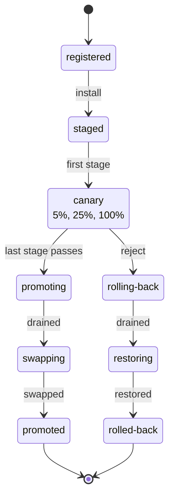

# The Lifecycle

A patch set moves through a fixed set of states, from registration through canary stages to promotion or rollback.
This chapter lists those states, what moves a set between them, and how an operator can step in.

## The States

Each state is a keyword stored in the set and read with `patch-set-state`.

| State | Meaning |
| --- | --- |
| `:registered` | Declared and checked; nothing is installed |
| `:vetoed` | A check or contract failed; nothing is live |
| `:installing` | `install` is running contracts and installing shims |
| `:staged` | Shims in place; all traffic on old code |
| `:canary-N` | A ramp stage with N percent of new tasks on new code |
| `:promoting` | New tasks run new code; old-pinned tasks drain |
| `:swapping` | New definitions being installed for good |
| `:promoted` | New code is the only code; shims gone |
| `:rolling-back` | New tasks run old code; new-pinned tasks drain |
| `:restoring` | Original definitions being put back |
| `:rolled-back` | Old code restored and verified |
| `:frozen` | Stopped for a human; new tasks run old code |

A set is vetoed by a static check at registration or by a contract at `install`.
A canary state names its percentage, such as `:canary-5`.
A set enters promoting when the last stage passes.
Swapping and restoring begin once the drain finishes.

`:promoted`, `:rolled-back`, and `:vetoed` are terminal.
An operator cannot move a set out of swapping or restoring, since code is changing in those states.

## Transitions



The diagram shows the two ways a set normally ends, with the default ramp.
A canary stage advances to the next stage, or to promotion after the last one.
It starts a rollback when a decision point says so.

Two states are left out of the diagram.
Installing sits between registered and staged, and a failing contract there vetoes the set.
A set can freeze from most states:

| From | Freezes When |
| --- | --- |
| A canary stage | A decision point says so |
| Promoting | Old-pinned tasks don't finish in time |
| Rolling back | New-pinned tasks don't finish in time |
| Restoring | The original definitions can't be restored and verified |

By default a canary stage freezes at a stage timeout or a confounded control arm.

An operator leaves the frozen state with `unfreeze`.
Its decision `:resume` goes back to the canary stage, `:rollback` starts a rollback, and `:promote` starts promotion.

Every transition is recorded in the set's history and in [The Audit Log](audit-log.md).

## Install

`install` takes a set name or the set itself, and the set must be registered.
It does four things in order:

1. It gives each patched class its union shape, so contracts that run new code can read the added slots (see [Class Migration](class-migration.md)).
2. It runs the pre-flight contracts; the first failure vetoes the set, reverts the class shapes, and signals `patch-vetoed`.
3. It installs the function and method shims, which route every call to old code until the first stage starts.
4. It marks the set staged and enters the first ramp stage.

A second `install` of the same set is refused with `illegal-transition`.

## How a Stage Ends

Every finished task reports its outcome to `report-outcome`, which feeds the stage's tests (see [Canary Statistics](canary-statistics.md)).
After each new-arm observation, the stage either continues or reaches a decision point:

- `:sprt-reject` when the error test or the latency test rejects.
- `:budget-pass` when the stage has scored its budget of new-arm observations.
- `:stage-timeout` when the stage has seen `stage-limit` new-arm observations without passing.

`stage-limit` defaults to 40,000 and is set per set with `defpatch-set`.
A stage timeout usually means the latency test never got a threshold, so few observations were scored.

The set's contracts also run again every 200 new-arm observations by default.
A failing runtime contract is decision point `:runtime-contract`.

Each stage starts with fresh tests and counts.
Evidence from a lucky 5% stage does not carry into the 25% stage.

## Hard Triggers

Some failures roll back without any test or decision point.
A failed forward instance migration arms the set's hard trigger.
So does a `storage-condition` raised by new-routed code.

The next outcome reported on either route during a canary stage takes the trigger and starts a rollback.
Both routes count because a migration failure can surface in a task on the old route.

## Confounded Control

During a canary stage, splice also watches the old code.
Every old-route outcome updates a ring of the 500 most recent control outcomes.
Once the ring holds 30 outcomes, a control failure rate above `confound-threshold` (0.15 by default) reaches decision point `:confounded`.
Its default is to freeze.

When the old code is failing that often, a comparison between the arms says nothing about the new code.

## Promotion

Promotion starts when the last stage passes, when an operator calls `promote`, or on `unfreeze` with `:promote`.
The set moves to promoting, and a background thread finishes the job:

1. New tasks pin to new code at once.
2. The thread waits for every task pinned to old code to finish.
3. It claims the set by moving it to swapping, unless something else moved it first.
4. It installs the new definitions, removes the shims, and gives each patched class its final shape.
5. It marks the set promoted.

The drain waits 10 seconds.
When old-pinned tasks are still running at the deadline, the set freezes instead of swapping.
This way no task that started on old code ever runs new code.

`seal-patch` releases a promoted set's migration journal.
After that, `roll-back` refuses the set.

## Rollback

Rollback starts from a decision point, a hard trigger, `roll-back`, or `unfreeze` with `:rollback`.
The set moves to rolling back, and `rollback-initiated` is signaled.
A background thread finishes the job:

1. Traffic goes to old code at once: the current fraction drops to 0.
2. The thread waits for every task pinned to new code to finish.
3. It claims the set by moving it to restoring.
4. It removes the shims, which puts the original functions and methods back.
5. It restores each patched class and migrates its instances back to the old shape.
6. It reads the image back and confirms every function, method, and class is in its old form.
7. It marks the set rolled back.

A drain timeout, or any part that is not restored, freezes the set.
`reverse-migration-report` returns the reversal counts from the last completed rollback.

A class patch declared `:lossy` cannot be reversed without losing data.
A rollback of a set with a lossy class freezes the set instead.
Only an operator's own `roll-back`, or `unfreeze` with `:rollback`, proceeds on such a set.

## Freezing

A frozen set routes every new task to old code and waits for a person.
Splice freezes a set at a stage timeout, a confounded control arm, or a drain timeout.
It also freezes a set at a failed restoration, a lossy rollback, and while an operator decides.

`freeze` takes a name, a reason, and an `:operator` keyword.
It works on a set in a canary stage, staged, rolling back, or promoting.
It returns `:no-change` on a frozen set and refuses every other state.

`unfreeze` takes a name, a decision, and an `:operator` keyword.

| Decision | Effect |
| --- | --- |
| `:resume` | Re-enter the set's stage, with fresh tests and counts |
| `:rollback` | Start a rollback, attributed to the operator |
| `:promote` | Start promotion, skipping the rest of the ramp |

`unfreeze` refuses a set that is not frozen, or an unknown decision.
Resume a set only when it was frozen from a canary stage (see [Resuming Other Freezes](#resuming-other-freezes)).

## Operator Functions

Each function takes a set name and an `:operator` keyword that goes into the audit log.
The keyword defaults to `"unspecified"`.
A refused request signals `illegal-transition`, whose readers name the current state and the request.

| Function | Works From | Returns |
| --- | --- | --- |
| `promote` | A canary stage or frozen | `:promoting` or `:no-change` |
| `roll-back` | A canary stage, staged, or frozen | `:rolling-back`, `:frozen`, or `:no-change` |
| `freeze` | A canary stage, staged, rolling back, or promoting | `:frozen` or `:no-change` |
| `unfreeze` | Frozen | The state change the decision makes |
| `seal-patch` | Promoted | `:sealed` or `:no-change` |

`:no-change` means the set is already where the call leads.
For `promote` that is promoting or promoted, and for `roll-back` it is rolling back or rolled back.
For `freeze` it is frozen, and for `seal-patch` it is sealed.
`roll-back` refuses a sealed set.

`wait-for-state` blocks until a set reaches one of a list of states.
Its signature is `(wait-for-state name-or-ps states &key (timeout 30))`, with the timeout in seconds.
It returns the state reached, otherwise `:timeout`.

```lisp
(splice:wait-for-state 'orders-v2 '(:promoted :rolled-back :frozen) :timeout 60)
```

`patch-set-lifecycle-history` returns the set's transitions, oldest first, as `(state . universal-time)` pairs.

## Operator Decisions

`with-operator-decisions` wraps a task loop.
On a thread inside it, each decision point asks a person instead of acting.

The set freezes first, so no second verdict can arrive and no new task routes to new code.
The worker thread then signals an `operator-decision` condition.
If no handler picks a restart, the thread enters the debugger with four restarts:

| Restart | Effect |
| --- | --- |
| `roll-back-patch` | Roll back and restore the old code |
| `freeze-patch` | Keep the set frozen; new tasks run old code |
| `promote-anyway` | Promote now, skipping the rest of the ramp |
| `let-splice-decide` | Do what splice would have done outside the macro |

Each restart has a function of the same name that takes the condition, in the manner of `abort` and `continue`.
The choice applies only if the set is still frozen for that decision.
If something else moved the set first (an operator `unfreeze` from another thread, say), the choice is dropped.
When two workers reach the same verdict, only the first asks.

Outside the macro, each decision point applies its default.

| Point | Reached When | Default |
| --- | --- | --- |
| `:sprt-reject` | The error or latency test rejects | Roll back |
| `:runtime-contract` | A runtime contract fails | Roll back |
| `:budget-pass` | A stage scores its budget | Advance, or promote after the last stage |
| `:stage-timeout` | A stage reaches `stage-limit` | Freeze |
| `:confounded` | Control failure rate exceeds `confound-threshold` | Freeze |

A set with a lossy class patch turns each roll-back default into a freeze.
Hard triggers are not decision points; they roll back, or freeze a lossy set, on any thread.

## Handling Decisions in Code

A handler can answer a decision without the debugger.
This one rolls back on any reject and lets splice decide everything else.

```lisp
(splice:with-operator-decisions
  (handler-bind ((splice:operator-decision
                   (lambda (c)
                     (if (eq :sprt-reject (splice:operator-decision-point c))
                         (splice:roll-back-patch c)
                         (splice:let-splice-decide c)))))
    (loop for id from 0
          while (splice::canary-stage-p (splice:patch-set-state ps))
          do (splice:with-task (:id id :swallow-errors t)
               (process-order id)))))
```

A handler that returns without invoking a restart lets the condition reach the debugger.

## Conditions

Every condition below except `unknown-patch-set` inherits from `splice-condition`.
Its reader `splice-condition-patch-set` returns the set.

| Condition | Kind | Readers | Signaled When |
| --- | --- | --- | --- |
| `patch-vetoed` | Error | `patch-vetoed-contract`, `patch-vetoed-detail` | A static check or pre-flight contract fails |
| `canary-anomaly` | Signal | `canary-anomaly-cause`, `canary-anomaly-task` | New-routed code errors inside a task |
| `canary-verdict` | Signal | `canary-verdict-stream`, `canary-verdict-direction`, `canary-verdict-n`, `canary-verdict-llr` | A stage rejects or passes |
| `migration-failure` | Error | `migration-failure-instance`, `migration-failure-direction`, `migration-failure-cause` | An instance migration fails |
| `rollback-initiated` | Signal | `rollback-initiated-trigger` | A rollback starts |
| `rollback-failure` | Error | `rollback-failure-cause` | Restoration fails, inside the rollback thread |
| `illegal-transition` | Error | `illegal-transition-from`, `illegal-transition-requested` | A request does not fit the set's state |
| `operator-decision` | Signal | `operator-decision-point`, `operator-decision-default`, `operator-decision-cause` | A decision point is reached inside `with-operator-decisions` |
| `unknown-patch-set` | Error | `unknown-patch-set-name` | A function gets a name nothing registered |

`canary-verdict-stream` is `:errors` or `:latency` on a reject and `:both` on a pass.
`canary-verdict-n` is the stage's count of new-arm observations, and `canary-verdict-llr` the test's log odds.
Callers never see `rollback-failure`; they see a frozen set instead.
A handler for any lifecycle condition may call the operator functions.

## Details

### Locks and Threads

`install` moves the set to `:installing` under the set's lock before anything else.
That is why a second `install` is refused.
Its last step, moving to `:staged` and entering the first ramp stage, holds the same lock.
Because of that, no task sees `:staged` with traffic on new code.

The promotion thread is named `splice-promote-<name>`, and the rollback thread `splice-rollback-<name>`.

Splice signals each lifecycle condition after it releases the set lock, so a handler may call the operator functions.
That includes `rollback-initiated` and `operator-decision`, which the worker thread signals.

### Check Order

After each new-arm observation, the stage's position is checked in this order:

1. The error test rejects: decision point `:sprt-reject`.
2. The latency test rejects: decision point `:sprt-reject`.
3. The stage scored its budget of new-arm observations: decision point `:budget-pass`.
4. The stage saw `stage-limit` new-arm observations without passing: decision point `:stage-timeout`.
5. None of these: the stage continues.

A reject wins over the budget, and the budget wins over the limit.
The runtime contracts run every `runtime-contract-interval` new-arm observations (200 by default).

### Freeze Reasons

| Reason | Set When |
| --- | --- |
| `:promotion-drain-timeout` | Old-pinned tasks are still running at the promotion drain deadline |
| A `:rollback-failure` reason | A rollback drain times out, or some part is not restored |
| `:lossy-reversal-needs-human` | A rollback reaches a set with a lossy class |
| `(:awaiting-operator :point ... :default ... :cause ...)` | A decision point is reached inside `with-operator-decisions` |

`rollback-failure` is caught inside the rollback thread, so callers see a frozen set with a `:rollback-failure` reason.

The promotion drain waits `*drain-timeout-seconds*` (internal, 10 seconds).

### Audit Events

Every transition is written to the audit log as a `:canary-transition` event.

If an operator froze the set during the promotion drain, the promotion thread leaves the set alone.
It audits `:transition-abandoned` instead.

An operator decision that arrives after something else moved the set is audited as `:decision-abandoned` and dropped.

`unfreeze` refuses a set that is not frozen, or an unknown decision, before it audits anything.

### Resuming Other Freezes

The code accepts `:resume` on any frozen set, including one frozen during a drain or a failed restoration.
In those cases it re-enters the canary stage by its index.
So resume a set only when it was frozen from a canary stage.

### Internal Names

`canary-stage-p`, used in the handler example, is internal.
The test suite uses it the same way in `test/integration/decisions.lisp`.
